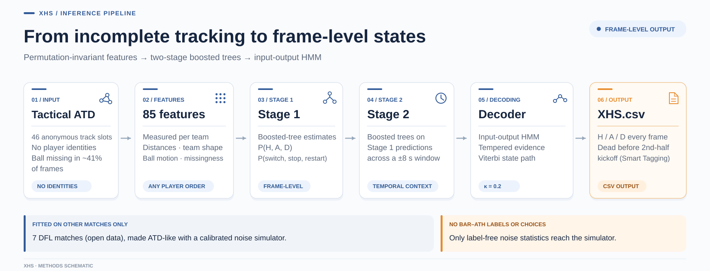

# More than a Hack 2027, Phase 1: ball possession

Our entry to [More than a Hack 2027](https://github.com/metrica-sports/more-than-a-hack-2027).
For every frame of the BAR-ATH tactical video it writes `H`, `A`, `D` or `X`.

Submitted file: `evaluation/results/XHS.csv`. Technical document: [docs/XHS.md](docs/XHS.md).



## Method (v2.4, as submitted)

The task is treated as segmentation, because spellF1 punishes a one-frame flicker as hard as a
missed possession:

1. **Evidence.** From 85 tracking features (collective speed; where the ball was last located
   and how it moves; each team's distance to it; touches and duels; how each block is placed),
   gradient-boosted trees give P(H, A, D) for every frame and the probability that possession
   switches, play stops or play restarts. A second stage reads how both move over ±8 s.
2. **Decoding.** An input-output HMM over H, A and D, its switch rate driven by the change
   classifier, decoded by Viterbi into one piecewise-constant path. A temperature (κ 0.2)
   sets how short a possession it accepts.
3. **Kickoffs.** The graded stretch before the second-half kickoff is dead; the kickoff is
   placed by Smart Tagging's kickoff window. Nothing else is read from Smart Tagging.

Every model was fitted on other matches: 7 DFL matches (IDSSE open data) made ATD-like by a
noise simulator calibrated to the ATD's label-free statistics. BAR-ATH carries no label, and its
public 5-minute window was used only as an alarm.

## Results

spellF1 on the held-out DFL matches under the ATD-calibrated noise, 5-95% bootstrap intervals.
DFL: the provider's own possession labels; M1 / M2: re-labelled by Metrica's rule (a touch
without control does not change possession) with 1 s / 2 s of control.

|                                         | DFL                      | M1                       | M2                       |
| --------------------------------------- | ------------------------ | ------------------------ | ------------------------ |
| `baseline_smooth50` (organisers' floor) | 0.268                    | 0.281                    | 0.286                    |
| v1 (rules + HMM)                        | 0.393                    | 0.430                    | 0.483                    |
| **v2.4 (submitted)**                    | **0.704** [0.687, 0.720] | **0.751** [0.740, 0.762] | **0.761** [0.750, 0.773] |

On matches of other providers, never trained or tuned on (M1): Metrica's sample games 0.834 as
provided and 0.802 with the ATD-calibrated noise (smooth50 0.441 / 0.334). On SkillCorner's
broadcast tracking v2.4 only draws level with v1 (0.390 / 0.392). On BAR-ATH itself there is no
label; the label-free diagnostics (290 possessions, median 7.1 s, 41% dead, stable when more of
the ball is removed) are in the technical document, section 2. The harness compares methods;
its absolute levels are not a forecast of the BAR-ATH score.

## Install

Python 3.11 (`.python-version`). Every dependency is pinned exactly.

```bash
git clone https://github.com/ouyang1030/metrica-hack && cd metrica-hack
python3.11 -m venv .venv && .venv/bin/pip install -r requirements.txt   # or: uv venv && uv pip install -r requirements.txt
.venv/bin/pip install -r requirements-dev.txt                            # tests and harness training
scripts/install_hooks.sh                                                 # once, after git init / clone
```

## Data

The match data is gated and is **not** in this repository. Unpack the organisers' bundle into
`./data/` with the names it ships with (`data/tactical/BAR-ATH_tactical_atd.txt`, …), or point
`MTAH_DATA_DIR` to it. Never commit it: `.gitignore` and the pre-commit hook both block it.

Off-game data (DATASETS.md), only for the harness, all under the gitignored `external/`:
`external/idsse/` (IDSSE / DFL, figshare), `external/metrica/` (the files of
github.com/metrica-sports/sample-data `data/Sample_Game_{1,2,3}/`), `external/skillcorner/`
(the `data/matches/` folder of github.com/SkillCorner/opendata, or a link to it).

## The one command

```bash
.venv/bin/python scripts/make_submission.py        # -> evaluation/results/XHS.csv
```

The command parses the bundle into `cache/` (first run only; `--rebuild-cache` after a new
bundle), runs the pipeline, writes the file and runs the official validator on it.

Two runs must give byte-identical files (`scripts/check_reproducibility.sh`). The parser is
checked separately: `scripts/reproduce_baselines.py` must rebuild the four published baselines
byte for byte.

Other entry points:

| command                                                                  | what it does                                                                                                                                                                                                                                                                                 |
| ------------------------------------------------------------------------ | -------------------------------------------------------------------------------------------------------------------------------------------------------------------------------------------------------------------------------------------------------------------------------------------- |
| `scripts/build_cache.py [--source all] [--force]`                        | parse the bundle into `cache/`                                                                                                                                                                                                                                                               |
| `scripts/reproduce_baselines.py`                                         | rebuild the four published baselines; compare them byte for byte with the committed files and with a fresh run of `starter/baseline.py`                                                                                                                                                      |
| `scripts/check_reproducibility.sh [expected.csv]`                        | two clean-room runs of HEAD (fresh export, fresh venv, empty cache); the files must be byte-identical                                                                                                                                                                                        |
| `scripts/smoke_test_public.py --reason "…" <csv>`                        | score against the public 5-minute window, as an alarm only; logs to COMPLIANCE_LOG.md                                                                                                                                                                                                        |
| `scripts/diagnose.py`                                                    | unsupervised diagnostics of our predictions on BAR-ATH: possessions and durations, the pre-kickoff stretch, agreement with Smart Tagging team tags, stability when more ball frames are removed                                                                                              |
| `scripts/calibrate_noise.py`                                             | fit the noise simulator to the ATD under STRICT (statistics and knobs go to `cache/aggregates/`, unseen); needed before `harness.train_v2`                                                                                                                                                   |
| `python -m harness.idsse` / `harness.score`                              | off-game harness: parse IDSSE, score the baselines                                                                                                                                                                                                                                           |
| `python -m harness.train_v2`                                             | (after `calibrate_noise.py`) cross-validate v2 against v1 and smooth50 (clean, degraded, stress; DFL's labels and Metrica's rule) and the ablations, save the out-of-fold outputs to `external/idsse/oof/`, then write `models/v2.json` (several hours; `harness.train_v1`: the same for v1) |
| `python -m harness.segments`                                             | (after `harness.train_v2`) where the decoded possessions go wrong: found, merged, split, missed, by length                                                                                                                                                                                   |
| `python -m harness.control`                                              | (after `harness.train_v2`) the decoder temperature against DFL's labels and Metrica's rule with 1-4 s of control                                                                                                                                                                             |
| `python -m harness.headroom`                                             | (after `harness.train_v2`) what perfect tracking or timing would buy, the evidence on lost short possessions, a minimum duration in the decoder                                                                                                                                              |
| `python -m harness.detector`                                             | (after `harness.metrica`, `calibrate_noise.py`) what a ball detector on the video could buy: the ATD-like copies with part of the lost ball given back                                                                                                                                       |
| `python -m harness.recovery`                                             | does the calibration recover known simulator knobs on DFL                                                                                                                                                                                                                                    |
| `python -m harness.metrica` / `harness.skillcorner` / `harness.external` | parse Metrica's sample games and SkillCorner's open data, then score the exported models on them                                                                                                                                                                                             |
| `python -m harness.sensitivity`                                          | (after `harness.metrica`, `calibrate_noise.py`) the exported models on Metrica's games with the noise moved, one knob at a time, where the calibration is uncertain                                                                                                                          |
| `python -m harness.figures [compute \| plot]`                            | (after `harness.train_v2`, `harness.metrica`, `harness.external`) the technical document's data figures, from off-game data only, to `docs/figures/`                                                                                                                                         |
| `.venv/bin/python -m pytest`                                             | tests (synthetic data only)                                                                                                                                                                                                                                                                  |

## Data firewall

The match data never reaches a hosted LLM (the competition's terms; `docs/XHS.md`, section 6). Any script that reads the match data runs through
`mtah/safe_run.py`. The script's console output goes to `debug/logs/`, which only humans read. The
terminal shows only approved lines: pass/fail checks, paths, the official validator's output and
summaries of our own predictions. An exception prints its type, a `file:line` and its
message with the digits masked. Input aggregates are written to `cache/aggregates/` and are not
printed (`FIREWALL_MODE = "STRICT"` in `mtah/config.py`).

## Layout

```
games.py, evaluation/, starter/   official files, copied from the official repository (LICENSE-METRICA)
mtah/                             our package
  config.py                       paths, team name, firewall mode
  safe_run.py                     the firewall
  atd.py                          FIFA/EPTS metadata + raw tracking parser (spec-driven)
  cache.py                        parse once into cache/, load arrays from it
  baseline.py                     starter/baseline.py, vectorised and bit-exact
  features.py                     per-frame tracking features (v1: compute, v2: matrix)
  trees.py                        gradient-boosted trees evaluated in numpy from JSON (v2)
  emissions.py                    v1 logistic evidence; tempered classifier evidence (v2)
  decoder.py                      HMM / Viterbi over H, A, D
  tagging.py                      Smart Tagging team tags, for the diagnostics
  pipeline.py                     cache -> labels (v2)
  submission.py, frames.py        write/validate/summarise a file; graded frames
scripts/                          entry points; hooks/ holds the pre-commit data guard
harness/                          off-game harness: IDSSE, Metrica and SkillCorner loaders, ATD
                                  noise simulator and its calibration, training, scoring
models/                           weights fitted on off-game data only (v2.json; v1.json)
tests/                            unit tests and the synthetic-bundle generator
docs/                             technical document (XHS.md) and its figures, organiser questions
EXPERIMENTS.md, COMPLIANCE_LOG.md, DATASETS.md
data/ cache/ debug/ external/      gitignored, never committed (external/: off-game downloads)
```

## Licence

Files under `games.py`, `evaluation/` and `starter/` are © Metrica Sports, MIT (see
`LICENSE-METRICA`), copied from the official repository. The match data is covered by neither licence.
