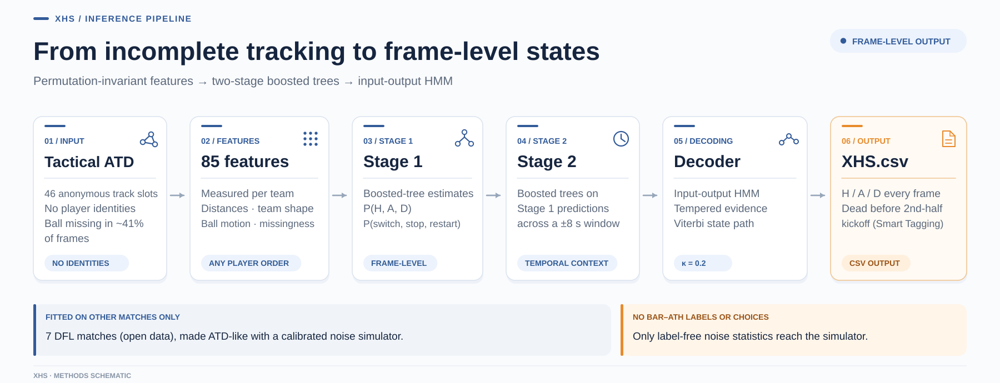
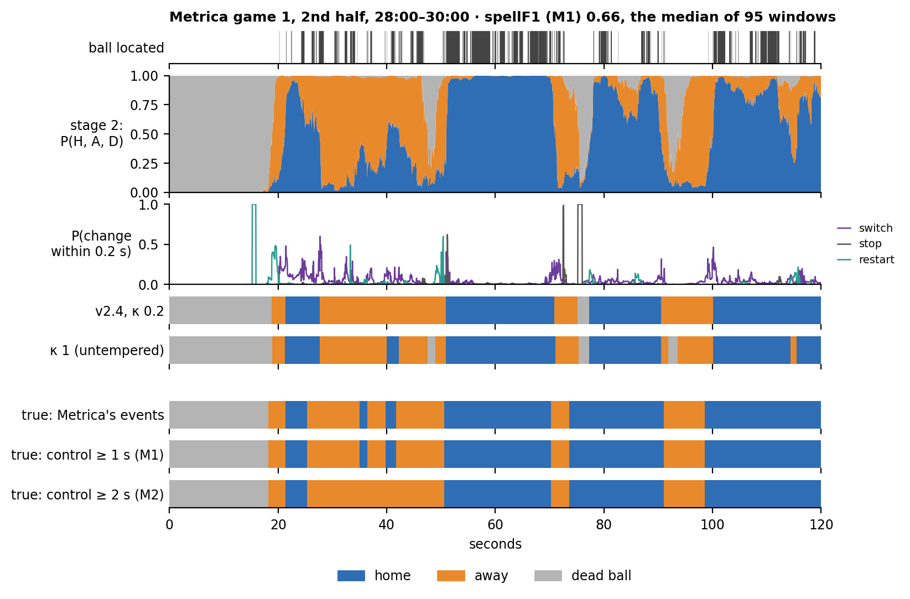
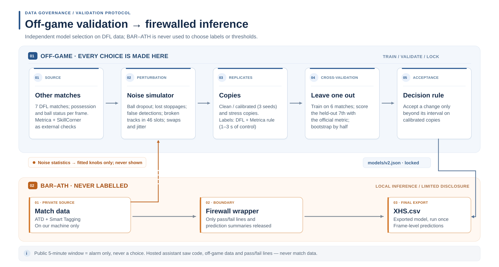
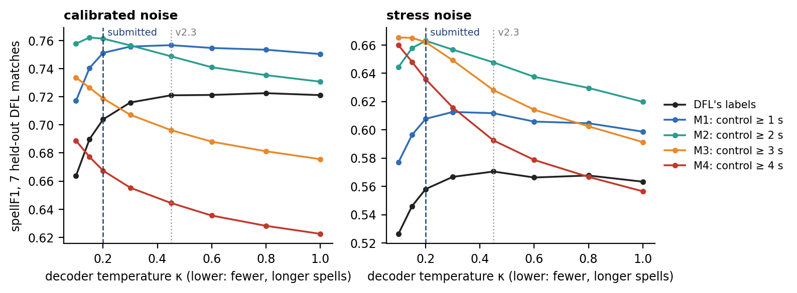
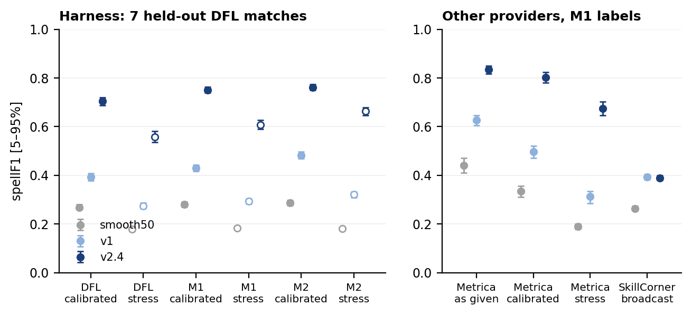
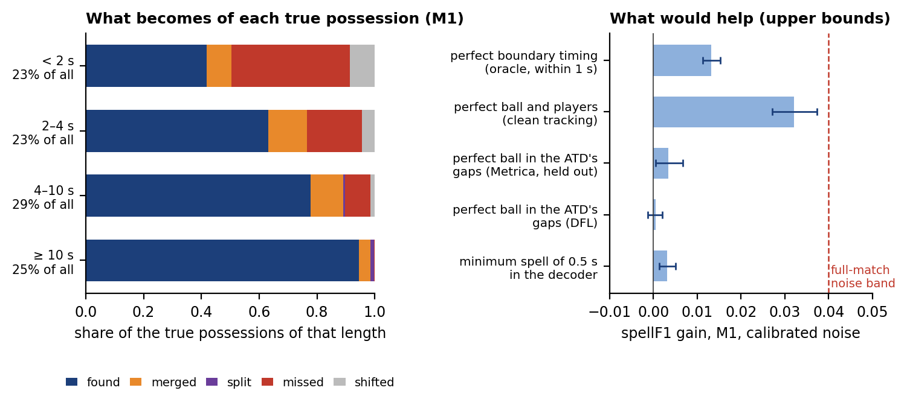

# XHS — ball possession from uncorrected tracking

More than a Hack 2027, Phase 1. Team `XHS`. Code: https://github.com/ouyang1030/metrica-hack

For every frame of the tactical video of BAR-ATH the pipeline writes `H`, `A` or `D`, from the
uncorrected tactical tracking (ATD) alone, plus Smart Tagging's kickoff windows. Every label
comes out of the algorithm; every parameter was fitted or chosen on other matches.



_Figure 1. The submitted pipeline (v2.4). From BAR-ATH it reads the ATD and Smart Tagging's
kickoff windows; every model in it was fitted on other matches._

## 1. Approach

**The task as segmentation.** spellF1 punishes a one-frame flicker as hard as a missed
possession, and a missed short stoppage as hard as a wrong team. So the pipeline does not
classify frames independently: it estimates per-frame evidence and then decodes one
piecewise-constant path over H, A and D.

**Evidence, learnt.** A gradient-boosted classifier gives P(H, A, D) for every frame from 85
tracking features, in windows of up to 2 s before and after the frame (the pipeline is offline,
so it may look ahead): how fast the players move together; where the ball was last located and
how it moves (towards which goal, how close to a line, how still); how close each team is to it;
the ball's changes of velocity next to a player of one team with no opponent nearer (touches)
and with both teams close (duels); how long each team has been nearest; how each team's block is
placed and moving towards the goal it attacks. A second classifier on the same features gives
the probability that possession switches, play stops or play restarts within 0.2 s. A second
stage reads how both classifiers' outputs move over up to 8 s before and after (stacked
sequential learning, trained on out-of-fold outputs) and re-estimates P(H, A, D).

**Decoding.** An input-output HMM over H, A and D: the evidence is tempered (kappa 0.2); the
probability of a switch, stop or restart at each frame follows the change classifier (gamma 1)
rather than a constant rate. Viterbi gives the most likely path. A stoppage always separates two
possessions, even of the same team. The temperature decides how much evidence a switch needs,
and so how short a possession the decoder will accept; it is set by the reading of "controlled
possession" (section 2).



_Figure 2. The method on two minutes of a Metrica sample game the model never saw, made
ATD-like at the noise simulator's default settings (the calibrated settings stay unseen under
the data firewall, section 6). From the top: frames on which the ball is located; stage 2's
P(H, A, D); the change detector; the decoded path at the submitted temperature and untempered;
the true path under three readings of controlled possession. The window is chosen by a rule --
of all 2-minute windows with at least two possessions and the ball in play at least 75% of the
time, the one with the median spellF1 -- not by hand. Untempered (kappa 1), the decoder follows
every short swing of the evidence, some real and some not; at 0.2 it keeps the longer spells._

**Symmetry.** Each team quantity is measured from that team's point of view and comes as a home
/ away pair; every classifier is trained on every frame twice, once with the teams swapped, so
it cannot favour either side.

**Why this rather than something else.** There are no labels for this match and none may be
made, so whatever learns must learn elsewhere; the hard part of the ATD is its noise (the ball
is missing on 41% of graded frames, players have no identities), so the training data must carry
that noise. Our first version (v1) used hand-written evidence (collective deceleration and balls
leaving the pitch for dead ball, the closer team for possession) with the same kind of decoder;
it found almost none of the possessions under 4 s. Learnt evidence over a wide, context-rich
feature table was the largest step (+0.22 spellF1 on the harness); a neural sequence model over
the raw player set would need far more than the seven labelled matches available, and the
learning curve of the trees was already flat (+0.008 per doubling of matches). The trees are
stored as JSON and evaluated in numpy, so the submission needs nothing beyond numpy and pandas.

## 2. Validation

The public 5-minute window has 17 possessions; it was used only as an alarm (three times for our
files, ranked table only, `COMPLIANCE_LOG.md`), never to choose anything. Every decision was
taken on an off-game harness:

- **Matches.** The seven IDSSE / DFL matches (2 Bundesliga, 5 2. Bundesliga), leave one match
  out (14 halves), scored with the official `possession_metrics.evaluate()`.
- **Noise.** A simulator turns DFL's clean tracking into ATD-like tracking: ball dropout
  (including a tracker that loses the ball in stoppages), false ball detections, 46 slots with
  fragmented tracklets, team errors and identity swaps, positional jitter. Its knobs were
  calibrated to label-free statistics of the ATD, computed and fitted locally and never
  printed (section 6). Every result is reported on
  calibrated copies (three seeds) and on a much noisier stress copy never trained on.
- **Label semantics.** DFL's notion of possession is not necessarily Metrica's. CHALLENGE.md
  says a touch without control does not change possession and suggests "a player keeps the ball
  for a few seconds" as a proxy for control, so every method is also scored on DFL's labels
  re-labelled by that rule: a spell of one team shorter than 1 s (M1), 2 s (M2) or 3 s (M3)
  between two spells of the other goes to the other. Classifier changes were judged on DFL and
  M1 and had to hold on M2; the decoder's temperature is chosen on M1-M3, with DFL as a check.
- **Decision rule.** A change is accepted when its paired gain on the degraded copies is
  beyond its 5-95% bootstrap interval; within noise, the simpler variant stays.



_Figure 3. Validation and data handling: every choice is made on other matches made ATD-like;
from BAR-ATH only label-free noise statistics flow back, and they are never shown._

**Results** (spellF1, calibrated copies [5-95%] / stress copy; macroF1 of v2.4 0.94 / 0.90):

|                                                  | DFL                              | M1                               | M2                               |
| ------------------------------------------------ | -------------------------------- | -------------------------------- | -------------------------------- |
| baseline_smooth50                                | 0.268 / 0.179                    | 0.281 / 0.184                    | 0.286 / 0.181                    |
| v1 (rules + HMM)                                 | 0.393 / 0.275                    | 0.430 / 0.294                    | 0.483 / 0.321                    |
| v2.3 (kappa 0.45, chosen on DFL and M1)          | 0.721 [0.706, 0.736] / 0.570     | 0.757 [0.746, 0.767] / 0.612     | 0.749 [0.738, 0.760] / 0.648     |
| **v2.4 (submitted; kappa 0.2, chosen on M1-M3)** | **0.704** [0.687, 0.720] / 0.558 | **0.751** [0.740, 0.762] / 0.608 | **0.761** [0.750, 0.773] / 0.663 |

The temperature trades one reading against another: against v2.3, v2.4 loses 0.017 on DFL's
labels and 0.005 under M1 and gains 0.013 under M2, 0.023 under M3 and 0.023 under a 4 s
control time (0.034 / 0.043 on the stress copy). Under M2 it predicts 1.02 times as many
possessions as there are.



_Figure 4. spellF1 against the decoder temperature on the 7 held-out DFL matches, per label
set. The temperature sets how short a possession the decoder accepts: DFL's labels favour a
higher one, the readings with 1-3 s of control a lower one; 0.2 is the best on M1-M3._

**What each choice is worth** (paired against the first stage alone, DFL labels, calibrated /
stress copies; the same holds under M1 and M2):

| change                                                               | spellF1         |
| -------------------------------------------------------------------- | --------------- |
| trained on clean tracking instead of degraded copies                 | -0.106 / -0.268 |
| feature windows that do not look ahead                               | -0.017 / -0.031 |
| no team-swapped training copies                                      | -0.006 / -0.011 |
| second stage over ±8 s                                               | +0.026 / +0.029 |
| then short possessions weighed more in training (v2.3, against v2.2) | +0.006 / -0.000 |

Training under the simulated ATD noise matters most: a model fitted on clean tracking is the
best on clean tracking (+0.04) and the worst under noise.

**Other providers** (never trained or tuned on; the exported models as submitted):

|                                                                     | smooth50 | v1    | v2    |
| ------------------------------------------------------------------- | -------- | ----- | ----- |
| Metrica sample games 1-3, as provided                               | 0.441    | 0.626 | 0.834 |
| the same, with the ATD-calibrated noise                             | 0.334    | 0.496 | 0.802 |
| the same, stress noise                                              | 0.190    | 0.312 | 0.674 |
| SkillCorner, 20 broadcast matches (real noise, ~16 players in view) | 0.264    | 0.392 | 0.390 |

(M1 labels. Metrica's labels are derived from Metrica's human event data by a written rule;
SkillCorner's from its automatic phases of play and possession group.)



_Figure 5. v2.4 against v1 and the organisers' floor `baseline_smooth50`, spellF1 with 5-95%
bootstrap intervals over halves. Left: the harness (filled: calibrated noise; hollow: stress
noise). Right: other providers' matches, never trained or tuned on (M1 labels)._

**Sensitivity to what the calibration could not pin down** (the exported models on Metrica's
games, the calibrated noise with one knob moved; spellF1 change of v2 / v1, M1 labels):

| if the ATD's noise differs by                            | v2                       | v1                       |
| -------------------------------------------------------- | ------------------------ | ------------------------ |
| ball found again 1 / 2 / 4 s later after a stoppage      | -0.010 / -0.030 / -0.067 | -0.005 / -0.013 / -0.032 |
| ball found again 1 s earlier                             | -0.001                   | +0.002                   |
| ball lost in play, in crowds, on 2 / 5 / 10% more frames | -0.014 / -0.032 / -0.054 | -0.006 / -0.013 / -0.026 |
| ball jitter +0.3 m                                       | -0.020                   | -0.010                   |
| players untracked on 5 / 10 / 20% more of their frames   | -0.004 / -0.001 / -0.025 | -0.004 / -0.017 / -0.033 |

v2 leans on a well-located ball more than v1 and loses about twice as much where the ball is
found late, lost in play or jitters; its lead over v1 stays above 0.27 in every case.

**On BAR-ATH** (no labels; diagnostics that catch bugs, never choose): 290 possessions,
durations p10 / p50 / p90 2.2 / 7.1 / 30.6 s, 41.1% of graded frames dead; 97.6% of the graded
stretch before the second-half kickoff predicted dead; agreement with Smart Tagging's team
phases 0.71 (attacking phases name the team we give the ball to) and 0.85 (defending phases name
the other); with the ball removed on about 10% more frames, 1.4% of graded frames change and
spellF1 against the original is 0.95. None of this predicts the score: the harness compares
methods, its absolute levels rest on DFL's labels and the simulator.

## 3. Assets used and dropped

| asset                                      | use                                                                                                                                                                                                                                                                                                                                                                                                                                                                                                                                                                                                                                   |
| ------------------------------------------ | ------------------------------------------------------------------------------------------------------------------------------------------------------------------------------------------------------------------------------------------------------------------------------------------------------------------------------------------------------------------------------------------------------------------------------------------------------------------------------------------------------------------------------------------------------------------------------------------------------------------------------------- |
| tactical ATD                               | the input                                                                                                                                                                                                                                                                                                                                                                                                                                                                                                                                                                                                                             |
| Smart Tagging                              | its kickoff windows place the second-half kickoff (the graded stretch before it is dead; the decoder places the restart inside the window). Its team phases as decoder evidence: implemented, weight set on the harness with a simulated tagger calibrated to Smart Tagging's vote statistics; weight 0, dropped: from a simulated tagger with errors independent of the tracking it adds at most +0.004 spellF1 on the calibrated copies, and from one that echoes the tracking it loses (EXPERIMENTS.md, 10-31 and 11-15); the code was removed before publication. Its team tags serve only the diagnostics (agreement, section 2) |
| tactical homography                        | parsed; not used. It maps the pitch onto the video's pixels, and we use no video. Where the camera points might say where the ball is while it is lost, but none of the off-game datasets has a camera to train or check that on, so it was not tried                                                                                                                                                                                                                                                                                                                                                                                 |
| tactical video, broadcast feed and its ATD | not used                                                                                                                                                                                                                                                                                                                                                                                                                                                                                                                                                                                                                              |
| the public 5-minute ground truth           | alarm only (alignment, label swap, half boundaries)                                                                                                                                                                                                                                                                                                                                                                                                                                                                                                                                                                                   |

## 4. Training data

IDSSE / DFL open data (Bassek, Rein, Weber & Memmert 2025, _Scientific Data_ 12:195, CC BY
4.0): 7 matches (2 Bundesliga, 5 2. Bundesliga), ~1.0M frames at 25 Hz, labels `BallStatus` and `BallPossession`
from DFL's official data. Nothing from the provided match, and no human-produced data about it
from any source. Metrica's sample games and SkillCorner's open data were used only to score the
exported models (section 2).

## 5. Possession rules implemented

v2 learns the frame evidence from DFL's labels instead of hand-written rules; the lines are drawn
by the features it sees, the decoder and the label rule it is judged by:

- **Loose balls and deflections.** No switch unless the evidence for the other team persists:
  the decoder's probability of a switch follows the change classifier, and a switch must
  then be carried by the evidence that follows, so a single touch or a deflection does not
  change possession. While nothing speaks for a change,
  possession stays with the last team, through ball flights and through stretches without a
  located ball.
- **Challenges.** The duel features (both teams within 1.5 m of the ball) and the touch
  features (a change of the ball's velocity next to a player with no opponent nearer) give the
  classifier what tells control from a contested touch; a duel won without subsequent control
  leaves possession where it was.
- **Short possessions.** Possessions shorter than 4 s weigh more in training, counted under
  M2 (control held for 2 s), so that only possessions every label set agrees on gain weight;
  the contested sub-second spells of DFL's labels do not. The decoder's temperature is the one
  that scores best when a spell held for less than 1-3 s is not a possession (M1-M3).
- **Dead ball and restarts.** Learnt from DFL's ball status: the players' collective slow-down,
  the ball last seen beyond a line or still, where and how long the ball is lost. A stoppage
  always separates two possessions. The team of the restart is the team the evidence gives the
  ball to as play resumes.
- **Kickoffs.** Graded frames before a half's Smart Tagging "Kick Off (Start)" window are dead;
  the pipeline checks that the windows contain the published kickoffs and exits with an error
  otherwise.
- **No abstention.** `X` is never written; every frame gets H, A or D.

## 6. Data handling

The code was written with Claude Code kept away from the match
data: it was blocked from the data folder, our caches and debug output; every script that reads
the data ran locally behind a wrapper (`mtah/safe_run.py`) that logs its output for the team and
passes on only pass/fail checks, the official validator's and scorer's output on our files, and
summaries of our own predictions. Statistics of the input that the simulator's calibration
needed were written to local files that the calibration code reads and the assistant did not.
Every look at the public window, every external dataset and every exception to this protocol is
recorded in `COMPLIANCE_LOG.md`.

## 7. Limitations, and what we would do with more time



_Figure 6. Left: what becomes of each true possession, by length (M1, calibrated noise; under
each length, its share of all possessions). Right: upper bounds on what perfect boundary
timing, perfect tracking, a perfect ball in the ATD's gaps or a minimum spell length would add;
the dashed line marks the ~0.04 below which full-match differences are noise._

- **Short possessions.** On the harness v2.4 finds 42% of DFL's possessions under 4 s (53% under
  M1, 63% under M2) and 85% of the longer ones, and predicts 0.75 times as many possessions as
  DFL's labels have (0.85 under M1, 1.02 under M2). The short ones are lost with the ball in
  view: what fails is telling a short controlled possession from a touch without control, which
  is also where the label sets disagree. On the lost ones the classifier's evidence is even
  (mean probability of the true team 0.51 under 2 s, 0.81 on the found ones), so no decoder
  recovers them: a minimum duration per spell changed nothing. Perfect boundary timing would add
  0.013, and perfect ball and player tracking 0.02-0.03, below the ~0.04 full-match band. The
  ball's gaps are not what limits v2: giving the simulated ATD's ball back exactly on every
  frame it lost buys at most 0.003, and given back in stoppages with a detector's error it costs
  up to 0.2, because the model reads a lost ball as a stoppage, so a ball detector on the video
  was not built. With more time: features that follow the ball across its flight from the player
  who plays it to the one who controls it next did not help (they duplicated the touch features
  and the second stage); a sequence model over the player set, trained on far more matches, is
  the step we would try.
- **Label semantics.** Which reading of "controlled possession" Metrica's ground truth follows
  decides how many short spells to predict. We chose the temperature on the readings with 1-3 s
  of control, after CHALLENGE.md; if the corrected tracking does name a team on a touch without
  control, kappa 0.45 would have been the better choice, by about 0.017 on DFL's labels. We
  have no statement from the organisers on which it is. The choice rests on the team's own
  reading of the rule: an opponent who only touches the ball without controlling it has not
  changed possession. How many seconds make control (1-3 s here) is likewise our reading.
- **The simulator.** When the ATD loses the ball is reproduced; when it finds it again, and how
  crowded the ball is when lost, are not. Half of the training copies are drawn between the
  calibrated and the stress noise to hedge this (+0.09 on the stress copy, equal on the
  calibrated copies). With more time: a dead-ball model with the ball carried to and placed on
  its restart spot (implemented, it reproduced nothing more), and a self-training round on
  BAR-ATH with algorithmic pseudo-labels.
- **Smart Tagging.** Its phases did not help on the harness even from a simulated tagger with
  errors independent of the tracking. Fused at weight 0.2, Smart Tagging would remove half of
  our possessions under 4 s on BAR-ATH, where the simulated tagger -- which reproduces Smart
  Tagging's vote statistics -- removes a tenth on the harness: those statistics do not
  constrain what a tagger does where a possession is short. Whether the possessions it would
  remove are right or wrong, only labels can tell; we left it out. (The fusion, the simulated
  tagger and its calibration were removed with the other dropped experiments before the
  repository was published.)
- **Broadcast-like tracking.** On SkillCorner's broadcast tracking (about 16 players in view,
  the ball lost where it leaves the picture) v2 only draws level with v1 on spellF1 (ahead on
  macroF1). Players missing at random cost v2 no more than v1 (section 2), so what hurts is
  what a broadcast camera loses systematically. The ATD is tracked from the tactical camera,
  and the simulator's untracked-player share was calibrated to it.
- **Dead-ball timing convention.** Where DFL starts and ends a stoppage relative to the ball
  crossing a line or the whistle need not be where Metrica's corrected tracking does; the harness
  cannot see such an offset, and we did not measure it on the public window.
- **One match, no feedback.** On the full match, spellF1 differences below ~0.04 are noise; the
  harness's absolute numbers are not a forecast.

## 8. Reproduction

```bash
git clone https://github.com/ouyang1030/metrica-hack && cd metrica-hack
python3.11 -m venv .venv && .venv/bin/pip install -r requirements.txt   # Python 3.11, exact pins
# unpack the organisers' bundle into ./data/ (or set MTAH_DATA_DIR)
.venv/bin/python scripts/make_submission.py        # -> evaluation/results/XHS.csv
```

About 25 s and 1.8 GB, the parse of the ATD included; the command runs the official
validator on the file it writes. `scripts/check_reproducibility.sh` exports the commit twice
into fresh directories with fresh virtual environments and empty caches, runs the command in
each, and checks that the two files are byte-identical (and identical to a given file);
`scripts/reproduce_baselines.py` checks the parser by rebuilding the four published baselines
byte for byte. The models are fitted on off-game data by `python -m harness.train_v2` (several
hours; README.md lists every entry point); the submission only runs inference with
`models/v2.json`.

## References

The work the method builds on (read for methods only; none of it is data about this match).

- Bengio & Frasconi (1995), _An input/output HMM architecture_, NIPS 7: the decoder, an HMM
  whose transition probabilities depend on the input (here, the change classifier).
- Bourlard & Morgan (1994), _Connectionist Speech Recognition: A Hybrid Approach_: classifier
  posteriors divided by class priors as scaled likelihoods for an HMM; the temperature kappa
  is that scale.
- Cohen & Carvalho (2005), _Stacked sequential learning_, IJCAI; Tu (2008), _Auto-context_,
  CVPR: the second stage, trained on out-of-fold first-stage outputs over long windows.
- Tobin et al. (2017), _Domain randomization_, IROS: half of the training copies are made with
  noise drawn between the calibrated and the stress settings.
- Vidal-Codina et al. (2022), _Sports Engineering_ (arXiv 2202.00804): touch, duel and gain
  features from tracking that separate control from a deflection.
- Link & Hoernig (2017), individual ball possession from tracking: control is graded, so a short
  touch is weak evidence.
- Lang et al. (2022), _Scientific Reports_: play in progress vs stopped from the players alone,
  with teams swapped in training.
- Kim et al. (2026), PathCRF (arXiv 2602.12080): constrained decoding with input-dependent
  transitions on the same DFL data.
- Ishikawa et al. (2021), ASRF, WACV; Farha & Gall (2019), MS-TCN, CVPR: a boundary detector
  beside the frame classifier, against over-segmentation.

## Acknowledgements

IDSSE / DFL open data: Bassek, Rein, Weber & Memmert (2025), _Scientific Data_ 12:195, CC BY
4.0. Sample tracking and event data by Metrica Sports (github.com/metrica-sports/sample-data).
Open broadcast tracking data by SkillCorner (github.com/SkillCorner/opendata, MIT).
